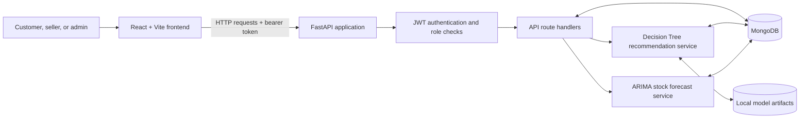
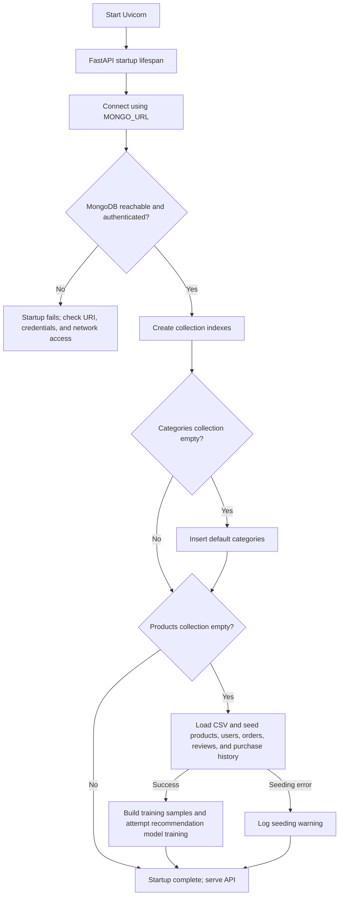
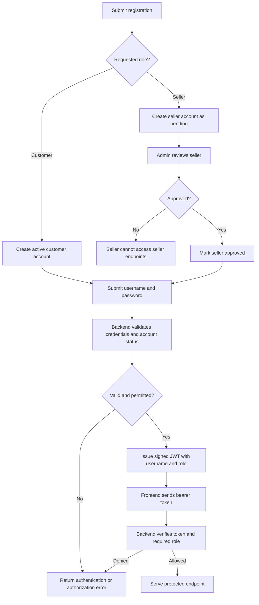
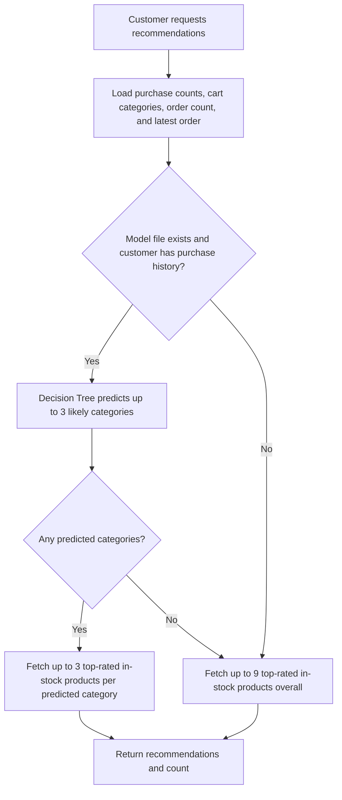
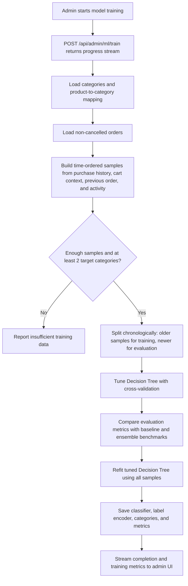
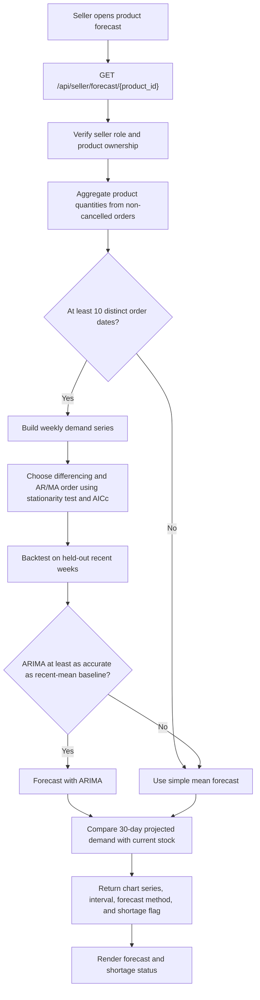

# Next Basket — Smart E-Commerce Platform

Predictive analytics and personalized recommendations for an enhanced e-commerce experience. Built with **FastAPI**, **MongoDB**, and **React + Vite**.

## System Overview

The React application calls the FastAPI backend over HTTP. FastAPI routes enforce role-based access, read and write application data through Motor, and call the forecasting and recommendation services when needed. MongoDB stores live application data; recommendation model artifacts and metrics are saved under `backend/ml_models/`.



### Contents

- [Features](#features)
- [Tech Stack](#tech-stack)
- [Project Structure](#project-structure)
- [Prerequisites](#prerequisites)
- [Setup & Running](#setup--running)
- [Default Dataset — Sample Superstore](#default-dataset--sample-superstore)
- [Application Flows](#application-flows)
- [Usage Flow](#usage-flow)
- [API Endpoints](#api-endpoints)
- [Database Collections](#database-collections)
- [Configuration](#configuration)

## Features

### 🤖 Machine Learning
- **ARIMA Sales Forecasting** — Time-series model that predicts 30-day product demand from order history, flagging potential stock shortages before they happen
- **Decision Tree Recommendations** — Next-basket recommendation engine trained on purchase history, cart context, previous orders, and order activity

### 🛒 Three-Role System
| Role | Capabilities |
|------|-------------|
| **Admin** | Approve/reject sellers, manage all users, products & orders, trigger ML model training, platform-wide stats |
| **Seller** | Add/manage products, view per-product ARIMA forecasts and stock alerts, sales analytics (monthly, by category, top products), process orders |
| **Customer** | Browse/search products, shopping cart, checkout, personalized next-basket recommendations, order history, product reviews |

## Tech Stack

| Layer | Technology |
|-------|-----------|
| Frontend | React 18, Vite, Tailwind CSS, Recharts, React Router |
| Backend | FastAPI (Python 3.11+), Motor (async MongoDB), JWT auth |
| Database | MongoDB |
| ML | statsmodels (ARIMA), scikit-learn (Decision Tree) |

## Project Structure

```
next_basket/
├── backend/
│   ├── app/
│   │   ├── main.py              # FastAPI entry point
│   │   ├── seed_data.py          # Auto-seeds Sample Superstore dataset on startup
│   │   ├── core/
│   │   │   ├── config.py         # Settings (env-based)
│   │   │   ├── database.py       # MongoDB connection & indexes
│   │   │   └── security.py       # JWT, bcrypt, role-based access
│   │   ├── models/              # Pydantic schemas
│   │   ├── routes/               # API endpoints (auth, admin, seller, customer, products, cart, orders)
│   │   └── services/
│   │       ├── arima_service.py          # ARIMA forecasting engine
│   │       └── recommendation_service.py # Decision Tree recommender
│   ├── data/
│   │   └── superstore_sales.csv   # Sample Superstore dataset (9,994 records)
│   ├── ml_models/               # Trained model artifacts (auto-generated)
│   ├── requirements.txt
│   └── .env
├── frontend/
│   ├── src/
│   │   ├── App.jsx              # Router
│   │   ├── api/                # Axios API client
│   │   ├── context/            # Auth & Cart context providers
│   │   ├── components/          # Navbar, ProtectedRoute, ProductCard
│   │   └── pages/              # admin/, seller/, customer/, shared/
│   ├── package.json
│   └── vite.config.js
└── README.md
```

## Prerequisites

1. **Python 3.11 or 3.12** (not 3.14 — pandas/scikit-learn wheels may not be available)
2. **Node.js 18+** and npm
3. **MongoDB** running locally on `localhost:27017`, or a MongoDB Atlas cluster. Set the connection string in `backend/.env` as `MONGO_URL`.

### Installing MongoDB
- **Windows**: Download from [mongodb.com](https://www.mongodb.com/try/download/community) and install as a service
- **macOS**: `brew install mongodb-community && brew services start mongodb-community`
- **Linux**: Follow the [official guide](https://docs.mongodb.com/manual/installation/)
- **MongoDB Atlas**: Create a cluster and a database user in Atlas, and add your machine's IP address to the project's Network Access list.

## Setup & Running

### 1. Backend

```bash
cd backend

# Create a virtual environment (recommended)
python -m venv venv
# Windows:
venv\Scripts\activate
# macOS/Linux:
source venv/bin/activate

# Install dependencies
pip install -r requirements.txt

# Create a .env file in this directory (see the Configuration section below)

# Start the API server
uvicorn app.main:app --reload --port 8000
```

The API will be available at `http://localhost:8000`. Interactive docs at `http://localhost:8000/docs`.

### 2. Frontend

```bash
cd frontend

# Install dependencies
npm install

# Start the dev server
npm run dev
```

The frontend will be available at `http://localhost:5173`.

### 3. Create an Admin Account

Admin accounts are stored in MongoDB like other users; there is no built-in
admin password. With the backend environment configured in `backend/.env`,
create the first admin interactively:

```bash
cd backend
python create_admin.py
```

The script prompts for the account details and password, stores only a
password hash, and refuses to overwrite an existing account.

## Deploying to Vercel

The root `vercel.json` configures two services: `backend` (FastAPI) and
`frontend` (Vite). Requests under `/api/` are routed to the backend; all other
paths are routed to the frontend. The frontend calls the API using the
same-origin `/api` path, which matches the backend's `/api` routes. The
frontend service rewrites client-side routes (such as `/login`) to
`index.html`, so directly opening or refreshing an app route works.

On Vercel, backend startup creates the MongoDB client without making database
network requests, creating indexes, or seeding demo data. This lets the
serverless function start independently of Atlas availability; API requests
still require a valid, reachable MongoDB instance. Customers should register
through the app unless sample data has been seeded into the production database
separately.

Connect the repository to Vercel and configure these environment variables for
the backend service in the Vercel project settings:

- `MONGO_URL`: a reachable MongoDB Atlas connection string; the local MongoDB
  default is not available in a Vercel deployment.
- `SECRET_KEY`: a unique, secure value for signing authentication tokens.

`DB_NAME` and other backend settings can also be configured as environment
variables when needed. To create a production admin, configure the same
`MONGO_URL` and `DB_NAME` locally in the untracked `backend/.env`, then run
`python create_admin.py` from `backend/`. This creates the account in the
database used by the deployment. Keep database credentials and secrets out of
the repository.

Check the API and MongoDB with the normal, public `GET /api/health` endpoint.
Open `https://<your-deployment-domain>/api/health` in a browser. It actively
pings MongoDB and returns `{"status":"ok","api":"ok","database":"connected"}`
when both are available. If MongoDB is unavailable, it returns HTTP 503 with
`"database":"disconnected"`, a safe error type, and a troubleshooting message.
The full exception is recorded in the backend function logs; credentials are
never returned.

## Default Dataset — Sample Superstore

On first local startup, the backend automatically seeds MongoDB with the **Sample Superstore** dataset ([Kaggle](https://www.kaggle.com/datasets/bravehart101/sample-superstore-dataset)), the same dataset used in the original project report for ARIMA sales forecasting. Vercel deployments skip automatic seeding; see [Deploying to Vercel](#deploying-to-vercel).

### What gets seeded

| Entity | Count | Source |
|--------|-------|--------|
| **Sellers** | 3 | One per category (Furniture, Office Supplies, Technology) |
| **Products** | ~1,862 | Unique products from the dataset |
| **Customers** | ~793 | Unique customers from the dataset |
| **Orders** | ~5,009 | Transactions grouped by Order ID (2015–2018 dates) |
| **Reviews** | ~1,500 | Generated from order data (profit-based ratings) |
| **Purchase tracking** | ~1,500 | Per-category purchase counts for recommendations |
| **ML model** | Auto-trained | Decision Tree trained on seeded purchase history |

### Seeded demo accounts

| Role | Username | Password |
|------|----------|----------|
| Seller (Furniture) | `furniture_seller` | `seller123` |
| Seller (Office Supplies) | `office_seller` | `seller123` |
| Seller (Technology) | `tech_seller` | `seller123` |
| Customer (example) | `claire_gute_cg12520` | `customer123` |
| Customer (example) | `sean_odonnell_so20335` | `customer123` |

All ~793 seeded customers use the password `customer123`. You can find their usernames by browsing the admin dashboard's customer list.

### Re-seeding

To re-seed the database from scratch, drop all collections in MongoDB and restart the backend:

```python
from pymongo import MongoClient
client = MongoClient('mongodb://localhost:27017')
db = client['next_basket']
for col in db.list_collection_names():
    db[col].drop()
```

## Application Flows

The diagrams below show the major request and data flows from application startup through customer and seller use.

### Backend startup and first-run data

MongoDB must be reachable and its credentials valid before the API can finish starting. The default-category seed runs when that collection is empty. The larger Sample Superstore seed runs only when the products collection is empty; it also builds purchase history and attempts to train the recommendation model.



### Registration, login, and role access

Customers can log in after registration. Seller accounts are created as pending and require admin approval before seller login succeeds. Successful login returns a signed JWT; the frontend sends it on protected requests, and backend role dependencies restrict access.



### Customer browse, cart, and checkout

The checkout route checks that each product exists and has enough stock before it updates stock, records purchased quantities by category, inserts an order, and clears that customer's cart. A seller can later view order items belonging to their account and update an order's status.

```mermaid
sequenceDiagram
    actor Customer
    participant UI as React frontend
    participant API as FastAPI routes
    participant DB as MongoDB
    actor Seller

    Customer->>UI: Browse products and add items to cart
    UI->>API: Product and cart requests (JWT)
    API->>DB: Read products; save cart items
    Customer->>UI: Place order
    UI->>API: POST /api/orders (JWT)
    API->>DB: Validate product IDs, existence, and available stock
    alt Invalid product or insufficient stock
        API-->>UI: Return an error; do not create the order
    else Stock is available
        API->>DB: Decrement product quantities
        API->>DB: Increment customer category purchase counts
        API->>DB: Insert pending order
        API->>DB: Clear customer's cart
        API-->>UI: Return order ID and success message
    end
    Seller->>UI: Open seller orders
    UI->>API: GET /api/orders/seller (JWT)
    API->>DB: Find orders containing this seller's items
    API-->>UI: Return only this seller's line items
    Seller->>UI: Update order status
    UI->>API: PATCH /api/orders/{order_id}/status
    API->>DB: Check seller ownership and save status
```

### Personalized recommendations

The recommendation request uses a customer's category purchase counts, current cart categories, latest order categories, and order count. If the saved model can provide predictions, the API returns top-rated in-stock products from predicted categories. If there is no usable prediction, it falls back to top-rated in-stock products overall.



### Admin recommendation-model training

Training can be initiated from the admin ML page. The API streams progress events while it loads non-cancelled order history and the product-to-category mapping, creates time-ordered samples, tunes a Decision Tree, compares benchmark models, refits the tuned tree on all samples, and saves the model, encoder, categories, and metrics under `backend/ml_models/`.



### Seller stock forecasting

The per-product forecast endpoint aggregates the selected product's non-cancelled sales history. With sufficient history, it creates weekly unit totals, selects ARIMA parameters, and backtests the forecast against a recent-mean baseline. Short histories use a mean forecast; a failed ARIMA fit also leaves the mean forecast in place. The resulting 30-day demand estimate is compared with current stock to flag a predicted shortage. The separate bulk stock-alert endpoint uses average daily sales to project demand and is not the per-product ARIMA forecast.



## Machine Learning Details

This application contains two separate ML workflows:

1. **Next-basket recommendations** are a supervised classification task. A tuned scikit-learn Decision Tree predicts product categories, then MongoDB is queried for products to show from those categories.
2. **Per-product sales forecasts** are time-series forecasts. The backend evaluates a selected ARIMA model against a simple recent-mean baseline before using it to estimate demand.

These are decision-support features: recommendations predict categories rather than exact products, and a forecast is an estimate based on recorded order history rather than a guarantee of future demand.

### Recommendation model: data and labels

The training source is non-cancelled order history and the product catalogue's product-to-category mapping. Orders are grouped by customer and ordered chronologically. For each order, the builder creates a sample for each category present in that order. The target label is that category; inputs are constructed only from information available before the order, plus the other categories present in that same order as basket context. Once a customer's samples for an order are created, that order's category quantities are added to their history for subsequent samples.

| Feature group | What the model receives |
|---------------|--------------------------|
| Purchase history | Per-category purchase counts normalized to each customer's share of historical units |
| Current basket context | Binary indicator for whether each category is present among the other categories in the target order |
| Previous order | Binary indicator for categories in the customer's immediately preceding order |
| Activity | `log1p` of the total units purchased and number of prior orders |
| Target | The category being purchased in the sample order |

This is category-level next-basket prediction. Search terms are tracked by an endpoint, but they are **not currently included** in the recommendation model's feature vector. Product ratings and inventory are applied after category prediction when selecting products to return.

### Recommendation model: training and validation

The admin training route streams progress to the frontend using Server-Sent Events (SSE). Training and model artifacts run on the backend host:

1. Load categories, product/category mappings, and non-cancelled orders from MongoDB.
2. Build chronological samples using each customer's history before each order.
3. Require at least **30 samples** and **two target categories**; otherwise, report insufficient data/classes.
4. Sort samples by time and use the oldest 80% for training and newest 20% for evaluation. If the test portion has fewer than 10 samples or the training portion has fewer than two classes, the implementation evaluates on all samples instead; in that case, the metrics are not a strictly held-out estimate.
5. Tune a class-weighted Decision Tree with stratified cross-validation. Grid-search candidates use `max_depth` values `4`, `6`, `8`, `12`, or unlimited; `min_samples_leaf` values `1`, `5`, or `20`; and either Gini or entropy criterion. Selection uses macro-F1.
6. Compare the tuned Decision Tree against a majority-category baseline, a 150-tree Random Forest, and Histogram Gradient Boosting. These are benchmarks; the **tuned Decision Tree** is the model deployed for recommendations.
7. Refit the selected Decision Tree on all available samples and save it with its label encoder, category list, and evaluation/training metadata.

The training metrics include:

| Metric | Meaning |
|--------|---------|
| Top-1 accuracy | Fraction of evaluation samples whose actual category is the highest-probability prediction |
| Top-3 accuracy | Fraction whose actual category appears among the model's three highest-probability categories |
| Macro-F1 | F1 score averaged equally across categories, useful when category frequencies differ |
| Cross-validation macro-F1 | Mean tuning score used to select the Decision Tree parameters |
| Per-class precision/recall | Evaluation precision and recall for each category |
| Feature importance | Decision Tree importance, grouped into history, basket context, previous order, and activity |

Metrics are for the available dataset and split; they should not be read as a guarantee of recommendation quality for every customer or future period.

### Recommendation inference and product selection

For a signed-in customer, the recommendations route builds the same kind of feature vector from:

- their `user_purchases` category counts;
- categories of products currently in their cart;
- categories found in their most recent order; and
- their number of orders.

The saved Decision Tree produces class probabilities. The API takes up to three categories with a probability above 1%, then queries each category for up to three in-stock products, ordered by average review rating. If the model is missing, incompatible with the current feature shape, or yields no category prediction—or the customer has no purchase history—the API falls back to up to nine in-stock products ranked by average rating and review count. The current fallback does not filter out previously purchased products.

The artifacts are loaded from disk when predictions are made. Keep the model files together and on the same backend host that serves the API:

| Artifact | Purpose |
|----------|---------|
| `backend/ml_models/rec_model.pkl` | Trained Decision Tree classifier |
| `backend/ml_models/rec_encoder.pkl` | Category label encoder |
| `backend/ml_models/categories.pkl` | Ordered category list used to build inference features |
| `backend/ml_models/rec_metrics.json` | Training metadata, evaluation metrics, benchmark results, and feature importance |

Retrain from the **Admin → ML** page after adding meaningful new order history or when categories/feature logic changes. An admin can also query `GET /api/admin/ml/status` to inspect whether the model and metrics are available.

### Sales forecasting: ARIMA and fallback behavior

The per-product forecasting service uses that seller's non-cancelled orders for the product:

1. Aggregate sold quantities by calendar date, filling dates with no orders as zero, then resample into weekly unit totals.
2. If there are fewer than **10 distinct order dates**, use a simple mean daily-demand forecast instead of ARIMA.
3. Otherwise, use the Augmented Dickey-Fuller test to choose the differencing order `d` (up to 2; stationarity threshold `p < 0.05`).
4. Search `p` and `q` from 0 through 2 and select the successful ARIMA candidate with the lowest corrected Akaike Information Criterion (AICc). If candidate fitting fails, the service has a `(0, 1, 0)` fallback.
5. Where enough weekly data is available, hold out the last 4–8 weeks and compare ARIMA with recent-mean and last-value baselines. ARIMA is selected over the recent-mean baseline only when its holdout MAE is no worse. If there is not enough history to backtest, the service attempts ARIMA directly.
6. Forecast enough weeks to cover 30 days, spread weekly estimates across daily chart values, and return a 95% interval where available. If fitting the final ARIMA forecast fails, retain the recent-mean forecast.
7. Sum the daily forecast and flag a shortage when predicted demand is greater than current stock. The response includes the selected method, forecast values, interval, total demand, current stock, and shortage units.

The seller's bulk `/api/seller/alerts` endpoint is a separate, faster calculation: it projects demand from average daily sales and does not run this per-product ARIMA/backtesting pipeline.

## API Endpoints

### Authentication
| Method | Path | Description |
|--------|------|-------------|
| POST | `/api/auth/register` | Register as customer or seller |
| POST | `/api/auth/login` | Login (returns JWT) |

### Products
| Method | Path | Description |
|--------|------|-------------|
| GET | `/api/products` | List products (filter, search, paginate) |
| GET | `/api/products/{id}` | Get product details |
| POST | `/api/products` | Create product (seller) |
| PUT | `/api/products/{id}` | Update product (seller) |
| DELETE | `/api/products/{id}` | Delete product (seller) |
| GET | `/api/products/{id}/reviews` | Get product reviews |
| POST | `/api/products/{id}/reviews` | Add review (customer) |

### Cart
| Method | Path | Description |
|--------|------|-------------|
| GET | `/api/cart` | Get cart contents |
| POST | `/api/cart/add` | Add item to cart |
| PUT | `/api/cart/{id}` | Update quantity |
| DELETE | `/api/cart/{id}` | Remove item |
| DELETE | `/api/cart` | Clear cart |

### Orders
| Method | Path | Description |
|--------|------|-------------|
| POST | `/api/orders` | Place order |
| GET | `/api/orders/my` | Customer's orders |
| GET | `/api/orders/seller` | Orders containing seller's products |
| PATCH | `/api/orders/{id}/status` | Update order status |

### Seller
| Method | Path | Description |
|--------|------|-------------|
| GET | `/api/seller/stats` | Dashboard stats |
| GET | `/api/seller/analytics/sales` | Sales analytics |
| GET | `/api/seller/forecast/{id}` | ARIMA forecast for product |
| GET | `/api/seller/alerts` | Stock shortage alerts |
| GET | `/api/seller/products` | Seller's products |

### Customer
| Method | Path | Description |
|--------|------|-------------|
| GET | `/api/customer/recommendations` | Next-basket recommendations |
| GET | `/api/customer/profile` | Get profile |
| PUT | `/api/customer/profile` | Update profile |

### Admin
| Method | Path | Description |
|--------|------|-------------|
| GET | `/api/admin/stats` | Platform stats |
| GET | `/api/admin/sellers` | List sellers |
| PATCH | `/api/admin/sellers/approve` | Approve/reject seller |
| GET | `/api/admin/products` | All products |
| DELETE | `/api/admin/products/{id}` | Delete any product |
| GET | `/api/admin/orders` | All orders |
| POST | `/api/admin/ml/train` | Train recommendation model |
| GET | `/api/admin/ml/status` | Check model status |

## Database Collections

| Collection | Purpose |
|-----------|---------|
| `users` | Customer & seller accounts (password hashed with bcrypt) |
| `products` | Product catalog |
| `categories` | Product categories |
| `cart` | Shopping cart items |
| `orders` | Order history with line items |
| `reviews` | Product ratings and comments |
| `user_purchases` | Aggregated per-category purchase counts (for recommendations) |
| `user_searches` | Search keyword tracking |

## Usage Flow

1. **Start MongoDB**, then the backend (`uvicorn`), then the frontend (`npm run dev`)
2. On first startup, the backend auto-seeds ~10K records from the Sample Superstore dataset (see above)
3. Open `http://localhost:5173`
4. Create an admin account with `python create_admin.py`, then log in to view platform-wide stats and manage sellers
5. Login as a seller (e.g. `furniture_seller` / `seller123`) to view stock forecasts, alerts, and analytics
6. Login as a customer (e.g. `claire_gute_cg12520` / `customer123`) to browse, shop, and see recommendations
7. The ML recommendation model is auto-trained during seeding — trigger retraining from Admin → ML page after new orders

## Configuration

Backend settings are in `backend/.env`:

```env
MONGO_URL=mongodb://localhost:27017
DB_NAME=next_basket
SECRET_KEY=change_this_in_production
ALGORITHM=HS256
ACCESS_TOKEN_EXPIRE_MINUTES=1440
```

For MongoDB Atlas, use the connection string provided by Atlas instead of the local URI. For example:

```env
MONGO_URL=mongodb+srv://<database-user>:<url-encoded-password>@<cluster-host>/?retryWrites=true&w=majority
```

Replace the placeholders with your Atlas **database user** and cluster hostname. The database user is created under Atlas **Database Access**; it is not your Atlas website login. If the password contains reserved URI characters such as `@`, `:`, `/`, or `#`, URL-encode those characters in the connection string. Also ensure your current IP address is allowed in Atlas **Network Access**. Keep `.env` private and never commit or share the connection string.

If startup fails with `bad auth : authentication failed` while creating a MongoDB index, the app reached Atlas but Atlas rejected the credentials. Check the database username and password, the cluster hostname, and any special characters in the password. If your MongoDB deployment requires a specific authentication database, include the appropriate `authSource` query parameter in `MONGO_URL`.

### Migrate a local database to MongoDB Atlas

The backend includes two ways to move data to the Atlas destination configured by `MONGO_URL` in `backend/.env`:

- **Restore a `mongodump` backup** with `backend/restore_mongodump_to_atlas.py`. Use this when you already have a MongoDB Database Tools dump.
- **Copy a live local database** with `backend/migrate_to_atlas.py`. The default source is `mongodb://localhost:27017`; source and destination database names default to `DB_NAME`.

#### Restore a `mongodump` backup

The checked backup in this workspace is under `C:\Users\SatheeshkumarK\Desktop\mongodb-database-tools-windows-x86_64-100.19.1\mongodb-database-tools-windows-x86_64-100.19.1\bin\dump` and contains `next_basket` with BSON and index metadata for 8 collections. To validate and restore only this database:

1. Make sure MongoDB Atlas is reachable, the database user's credentials are valid, and your current IP address is allowed in Atlas Network Access.
2. Set `MONGO_URL` in `backend/.env` to the Atlas connection string and confirm `DB_NAME` is the database you intend to migrate.
3. From PowerShell, run a dry run first:

   ```powershell
   cd backend
   python restore_mongodump_to_atlas.py `
     --dump-dir "C:\Users\SatheeshkumarK\Desktop\mongodb-database-tools-windows-x86_64-100.19.1\mongodb-database-tools-windows-x86_64-100.19.1\bin\dump" `
     --tool "C:\Users\SatheeshkumarK\Desktop\mongodb-database-tools-windows-x86_64-100.19.1\mongodb-database-tools-windows-x86_64-100.19.1\bin\mongorestore.exe" `
     --dry-run
   ```

4. If Atlas is reachable and the backup/target database are correct, explicitly confirm and restore:

   ```powershell
   python restore_mongodump_to_atlas.py `
     --dump-dir "C:\Users\SatheeshkumarK\Desktop\mongodb-database-tools-windows-x86_64-100.19.1\mongodb-database-tools-windows-x86_64-100.19.1\bin\dump" `
     --tool "C:\Users\SatheeshkumarK\Desktop\mongodb-database-tools-windows-x86_64-100.19.1\mongodb-database-tools-windows-x86_64-100.19.1\bin\mongorestore.exe" `
     --apply `
     --confirm-database next_basket
   ```

The backup restore script uses `mongorestore` to import only `next_basket.*`, including its BSON data and dump index metadata. It does not use `--drop`; existing collections are not deliberately deleted. If the destination already contains documents with the same `_id`, MongoDB can report duplicate-key errors, so back up/check the Atlas destination before restoring. The Atlas URI is passed to the tool through a temporary config file rather than a command-line argument, and that file is removed after the process exits.

The live-copy script copies collection documents with their original `_id` values, recreates indexes, copies views, and verifies destination document counts. By default, it refuses to write if the destination database already contains collections. If you intentionally want to merge into an existing target, use `--merge`: source documents replace destination documents with the same `_id`, while destination-only documents are left intact. It does not drop collections or delete destination-only records.

For either script, if your network uses a private TLS inspection CA, pass its trusted CA bundle with `--tls-ca-file C:\path\to\trusted-ca.pem`; certificate verification remains enabled. Do not use an insecure TLS bypass. For live-copy, select another local source or database with `--source-uri`, `--source-db`, or `--target-db`. Do not put credentials in command-line arguments; the Atlas URI should remain in the ignored/private `backend/.env` file.

## License

This project is a B.Tech academic project by Satheesh Kumar K, Hindusthan Institute of Technology, Coimbatore.
